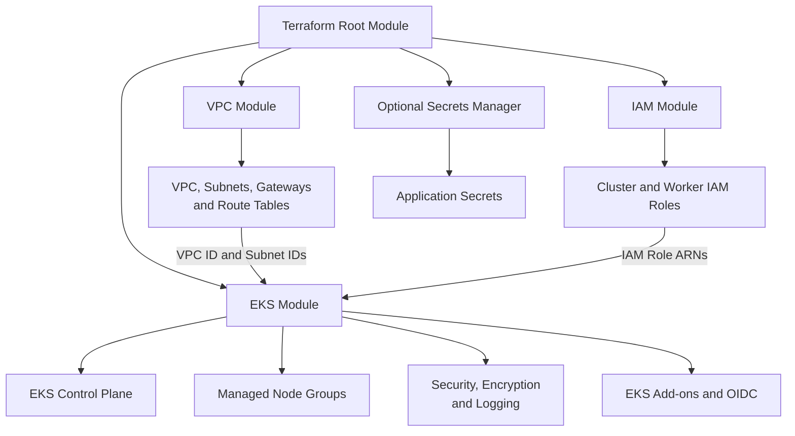

# Modular Amazon EKS Infrastructure with Terraform

## Project Overview

This project explores how to provision and organize AWS infrastructure for Amazon EKS using reusable custom Terraform modules. It was developed as part of the **30 Days of AWS Terraform** challenge.

The infrastructure is organized into four modules:

- **VPC:** Creates networking components, including public and private subnets across three Availability Zones, Internet Gateway, NAT Gateway, and route tables.
- **IAM:** Defines separate IAM roles and policy attachments for the EKS control plane and worker nodes.
- **EKS:** Configures the EKS cluster, managed node groups, security groups, encryption, CloudWatch logging, EKS add-ons, and OIDC integration for IRSA.
- **Secrets Manager (optional):** Supports storing database credentials, API keys, and application configuration secrets.

## Architecture

The root Terraform module coordinates the child modules and passes values between them using module inputs and outputs.

## Key Learning Outcomes

- Organizing infrastructure into custom Terraform modules.
- Passing configuration through input variables and exposing values through outputs.
- Understanding dependencies between networking, IAM, and EKS resources.
- Configuring multi-AZ networking and private worker-node subnets.
- Exploring Kubernetes infrastructure, encryption, logging, and workload identity integration.

## Project Notes

This is a hands-on infrastructure learning project. The configuration illustrates the intended architecture; deployment and production readiness should be verified separately.

---

## Documentation and Learning References

The references below are retained for future practice, troubleshooting, and deeper understanding of the Terraform resources and AWS services used in this project.

[Amazon EKS cluster IAM role](https://docs.aws.amazon.com/en_en/eks/latest/userguide/cluster-iam-role.html?utm_source=chatgpt.com)

[Amazon Elastic Kubernetes Service Documentation](https://docs.aws.amazon.com/eks/?icmpid=docs_homepage_containers)

[What is Amazon EKS?](https://docs.aws.amazon.com/eks/latest/userguide/what-is-eks.html)

# Modules>IAM>main.tf
- [Resource: aws_iam_role](https://registry.terraform.io/providers/hashicorp/aws/latest/docs/resources/iam_role)
- [Resource: aws_iam_role_policy_attachment](https://registry.terraform.io/providers/hashicorp/aws/latest/docs/resources/iam_role_policy_attachment)

# Modules>IAM>output.tf
- [output block reference](https://developer.hashicorp.com/terraform/language/block/output)

# Modules>IAM>variables.tf
- [variable block reference](https://developer.hashicorp.com/terraform/language/block/variable)

# Modules>eks>main.tf
- [Resource: aws_kms_key](https://registry.terraform.io/providers/hashicorp/aws/latest/docs/resources/kms_key)
- [Resource: aws_kms_alias](https://registry.terraform.io/providers/hashicorp/aws/latest/docs/resources/kms_alias)
- [CloudWatch Logs>Resource: aws_cloudwatch_log_group](https://registry.terraform.io/providers/hashicorp/aws/latest/docs/resources/cloudwatch_log_group)
- [EC2 (Elastic Compute Cloud)>List Resource: aws_security_group](https://registry.terraform.io/providers/hashicorp/aws/latest/docs/list-resources/security_group)
- [VPC>Resource: aws_security_group](https://registry.terraform.io/providers/hashicorp/aws/latest/docs/resources/security_group)
- [VPC>Resource: aws_security_group_rule](https://registry.terraform.io/providers/hashicorp/aws/latest/docs/resources/security_group_rule)
- [Provider>hashicorp>tls>v3.4.0>tls_certificate (Data Source)](https://registry.terraform.io/providers/hashicorp/tls/3.4.0/docs/data-sources/certificate)
- [Hashicorp>TLS Provider](https://registry.terraform.io/providers/hashicorp/tls/3.4.0/docs)
- [IAM (Identity & Access Management)>Resource: aws_iam_openid_connect_provider](https://registry.terraform.io/providers/hashicorp/aws/latest/docs/resources/iam_openid_connect_provider)
- [EKS>Resource: aws_eks_node_group](https://registry.terraform.io/providers/hashicorp/aws/latest/docs/resources/eks_node_group)
- [EC2>Resource: aws_launch_template](https://registry.terraform.io/providers/hashicorp/aws/latest/docs/resources/launch_template)
- [EKS>Resource: aws_eks_addon](https://registry.terraform.io/providers/hashicorp/aws/latest/docs/resources/eks_addon)

# Modules>eks>output.tf
- [output block reference](https://developer.hashicorp.com/terraform/language/block/output)

# Modules>eks>variables.tf
- [variable block reference](https://developer.hashicorp.com/terraform/language/block/variable)

# Modules>Secret_manger>main.tf
- [kms>Resource: aws_kms_key](https://registry.terraform.io/providers/hashicorp/aws/latest/docs/resources/kms_key)
- [kms>Resource: aws_kms_alias](https://registry.terraform.io/providers/hashicorp/aws/latest/docs/resources/kms_alias)
- [Secrets Manager>Resource: aws_secretsmanager_secret](https://registry.terraform.io/providers/hashicorp/aws/latest/docs/resources/secretsmanager_secret)
- [Resource: aws_iam_policy](https://registry.terraform.io/providers/hashicorp/aws/latest/docs/resources/iam_policy)

# Modules>Secret_manger>output.tf
- [output block reference](https://developer.hashicorp.com/terraform/language/block/output)

# Modules>Secret_manger>variables.tf
- [variable block reference](https://developer.hashicorp.com/terraform/language/block/variable)

# Modules>VPC
- [Resource: aws_vpc](https://registry.terraform.io/providers/hashicorp/aws/latest/docs/resources/vpc)
- [EC2>Resource: aws_eip](https://registry.terraform.io/providers/hashicorp/aws/latest/docs/resources/eip)

---

## [Hashicorp>TLS Provider](https://registry.terraform.io/providers/hashicorp/tls/3.4.0/docs)

The data "tls_certificate" data source is provided by the HashiCorp TLS Provider. It is used to fetch a TLS certificate chain from a specific HTTPS URL, which is most commonly utilized to retrieve a certificate's SHA-1 fingerprint (thumbprint). [1, 2]  

This is a critical requirement when setting up OpenID Connect (OIDC) identity providers in cloud platforms like AWS (e.g., configuring AWS IAM roles for service accounts in Amazon EKS or configuring dynamic provider credentials for HCP Terraform). [3, 4] 

------------------------------

## 💻 Syntax & Usage## 1. Modern Configuration (TLS Provider v4.x+)
In modern versions of the provider, fetched attributes are organized inside a certificates block array. [3, 5] 

# Fetch the certificate chain
data "tls_certificate" "example" {
  url = "https://githubusercontent.com"
}

# Create an OIDC provider using the retrieved certificate fingerprint
resource "aws_iam_openid_connect_provider" "example" {
  url             = data.tls_certificate.example.url
  client_id_list  = ["sts.amazonaws.com"]
  thumbprint_list = [data.tls_certificate.example.certificates[0].sha1_fingerprint]
}

## 2. Legacy Configuration (TLS Provider v3.x or earlier)
If you are locked into using older provider versions (like v3.4.0), the fingerprint was exposed as a flat string attribute (sha1_fingerprint) directly on the data source root: [1] 

resource "aws_iam_openid_connect_provider" "legacy_example" {
  url             = data.tls_certificate.example.url
  client_id_list  = ["sts.amazonaws.com"]
  thumbprint_list = [data.tls_certificate.example.sha1_fingerprint] 
}

------------------------------
## ⚙️ Arguments Reference

* url (String, Required): The initialization URL from which to download the certificate chain. Must begin with https://. [2] 
* verify_chain (Boolean, Optional): Dictates whether to verify the server's certificate chain against your system's trust store. Defaults to true.

------------------------------
## 📤 Exported Attributes
When leveraging certificates[0], you can access detailed information about the remote certificate: [1, 3] 

| Attribute | Type | Description |
|---|---|---|
| certificates[*].sha1_fingerprint | String | The SHA-1 fingerprint/thumbprint of the certificate (Hexadecimal format). |
| certificates[*].cert_pem | String | The complete certificate data string encoded in PEM format. |
| certificates[*].not_after | String | Expiration time timestamp formatted according to RFC 3339. |
| certificates[*].not_before | String | Activation/validity start time timestamp. |
| certificates[*].issuer | String | The entity that verified and signed the certificate. |
| certificates[*].subject | String | The entity to which the target certificate belongs. |

------------------------------
## ⚠️ Common Pitfalls

* Proxy Issues: If your Terraform setup runs behind an enterprise firewall or private network proxy, the data fetch might time out. You can configure a proxy block directly inside the provider "tls" {} block. [2] 
* Invalid index Error: If you upgrade or downgrade across the v3.x / v4.x barrier without adjusting data.tls_certificate.example.sha1_fingerprint vs data.tls_certificate.example.certificates[0].sha1_fingerprint, your code will fail to compile. [5] 

* What cloud platform or service (AWS, GitHub, EKS, etc.) you are integrating with.
* What provider version your infrastructure codebase currently targets.

[1] [https://registry.terraform.io](https://registry.terraform.io/providers/hashicorp/tls/3.4.0/docs/data-sources/certificate)
[2] [https://registry.terraform.io](https://registry.terraform.io/providers/hashicorp/tls/latest/docs)
[3] [https://www.hashicorp.com](https://www.hashicorp.com/en/blog/access-aws-from-hcp-terraform-with-oidc-federation)
[4] [https://registry.terraform.io](https://registry.terraform.io/providers/hashicorp/aws/4.49.0/docs/resources/eks_cluster)
[5] [https://github.com](https://github.com/hashicorp/terraform/issues/31496)

